<div align="center">
  
  

  <h1>Sky Optimizers</h1>

  <p><strong>Watch Particle Swarm Optimization and the Grey Wolf Optimizer search the same landscape, step by step, in 3D.</strong></p>

  <p>An interactive teaching animation for metaheuristics, with a narrated explainer on how both are used in cloud computing.</p>

  <p>
    <a href="https://aryarefman.github.io/metaheuristik-pso-gwo/"></a>
    
    
    
    
    
  </p>

  <p>
    <a href="#try-in-three-steps"><strong>Try it</strong></a> ·
    <a href="#features"><strong>Features</strong></a> ·
    <a href="#screenshots"><strong>Screenshots</strong></a> ·
    <a href="#how-the-algorithms-work"><strong>Algorithms</strong></a> ·
    <a href="#architecture"><strong>Architecture</strong></a> ·
    <a href="#repository-structure"><strong>Structure</strong></a>
  </p>

  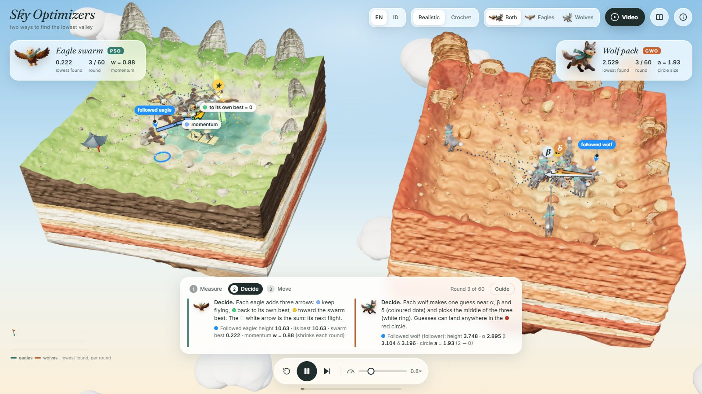
</div>

> [!NOTE]
> A school project. Every movement on screen comes from the real update rules in [`src/js/10_algorithms.js`](src/js/10_algorithms.js); the 3D scene only displays the algorithms' state, it never invents motion.

## Table of Contents

1. [Why this exists](#why-this-exists)
2. [Summary](#summary)
3. [Features](#features)
4. [Screenshots](#screenshots)
5. [Try in three steps](#try-in-three-steps)
6. [Pages and versions](#pages-and-versions)
7. [Running locally](#running-locally)
8. [How the algorithms work](#how-the-algorithms-work)
9. [Architecture](#architecture)
10. [Validation and limitations](#validation-and-limitations)
11. [Testing](#testing)
12. [Repository structure](#repository-structure)
13. [Other documentation](#other-documentation)
14. [License and attribution](#license-and-attribution)

## Why this exists

Metaheuristics are usually taught with equations and convergence plots, which hide the part that matters: **how a group of simple agents, each seeing only its own spot, still finds a good answer.**
This project makes that visible. Two floating islands share the **same landscape** (the ground height is the cost function) and the **same start positions**, so you can compare the two algorithms fairly, step by step.

| | PSO · eagles | GWO · wolves |
| :--- | :--- | :--- |
| Island | jade lake, karst towers, pavilion, fisherman on a bamboo raft | dry sandstone canyon, mesas, hoodoos, no water |
| Rule | `v = w·v + c1·r1·(pbest − x) + c2·r2·(gbest − x)` | `X = (X1 + X2 + X3) / 3`, `Xk = Xleader − A·\|C·Xleader − X\|` |
| On screen | momentum, own-best and swarm-best arrows, pbest gems, gbest star | α β δ leaders, guide arrows, X1–X3 guesses, shrinking search circle |

## Summary

- **Real algorithms.** PSO with linearly decreasing inertia; GWO with the standard α/β/δ update. Seeded, repeatable runs.
- **One round, three steps.** *Measure → Decide → Move*, each shown separately and narrated in plain words.
- **Built to be understood.** First-visit introduction, live narrator panel, labelled arrows, optional Guide mode, in-depth tabs with every symbol explained.
- **A narrated video.** Twelve chapters on how PSO and GWO schedule jobs in cloud computing, synchronised with the live 3D animation.
- **Two styles, two languages.** Realistic or crochet look; English or Bahasa Indonesia.

## Features

| Feature | Description |
| :--- | :--- |
| Side-by-side islands | Same objective, same seed, same start: a fair visual comparison of PSO and GWO. |
| Step-by-step rounds | Measure, Decide and Move are separate stages; the step pill and narrator say which one is running. |
| Labelled vectors | The followed eagle shows momentum, own-best and swarm-best arrows and their sum; the followed wolf shows its three guide arrows, its guesses and their average. |
| Follow any animal | Click an eagle or wolf: it gets a blue ring, pin and label, is drawn in front of the other animals, and the narrator shows its numbers. |
| Guide mode | Optional: pauses at every step until you press **Continue**. **Play** otherwise runs the whole search on its own. |
| Explainer video | 12 chapters: cloud scheduling, makespan, why exhaustive search is impossible, PSO, PSO formula, PSO in the cloud, GWO, GWO formula, GWO in the cloud, comparison, summary. Voice + captions, chapter bar, keyboard control. |
| Video ↔ animation sync | In the animation chapters each sentence plays exactly its step (Measure / Decide / Move), and only the swarm being explained moves. |
| In-depth tabs | Legend, *PSO in depth*, *GWO in depth*: symbol tables, pseudocode, why each works, a PSO vs GWO comparison. |
| Four landscapes | Ackley, Sphere, Rastrigin, Himmelblau. |
| Live readouts | Lowest value found, round, w / a, and a convergence chart. |
| Realistic or crochet | PBR rock, water and felt mascots, or everything crocheted in yarn. Same scene and algorithms. |
| English or Indonesian | Every string, including the narration and the formulas' labels; Indonesian uses decimal commas. |
| Works anywhere | Double-click the HTML file. Desktop and phone layouts, keyboard shortcuts, reduced-motion support. |

## Screenshots

| | |
| :---: | :---: |
| 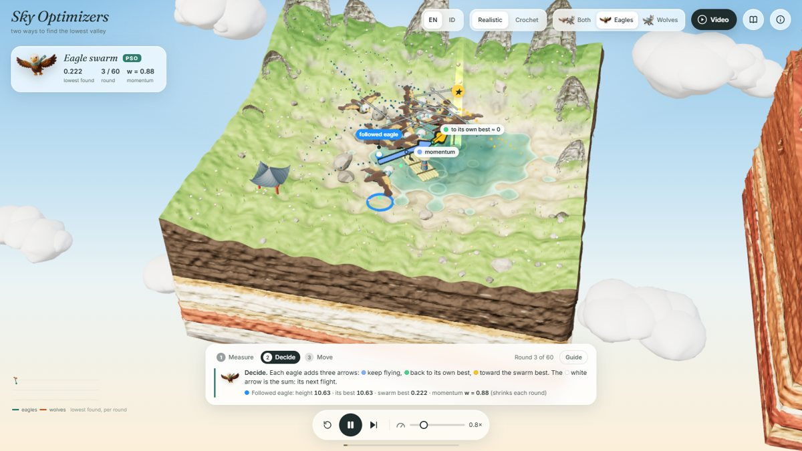<br/>**Eagles (PSO).** The followed eagle's three pulls and their sum | 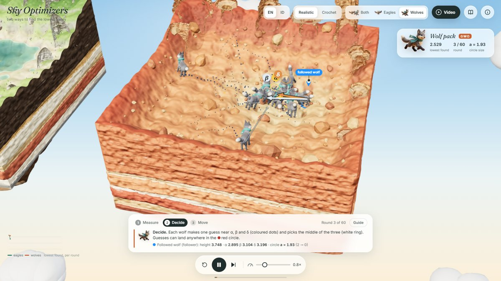<br/>**Wolves (GWO).** Guide arrows to α, β, δ and the search circle |
| 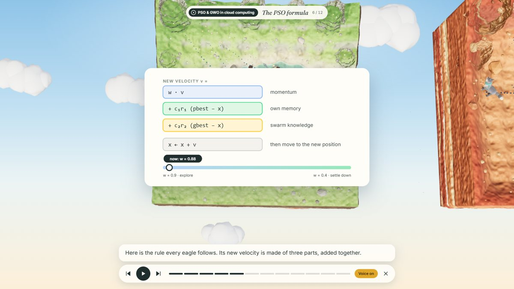<br/>**Video: the PSO formula.** Each term with its meaning and the live w | 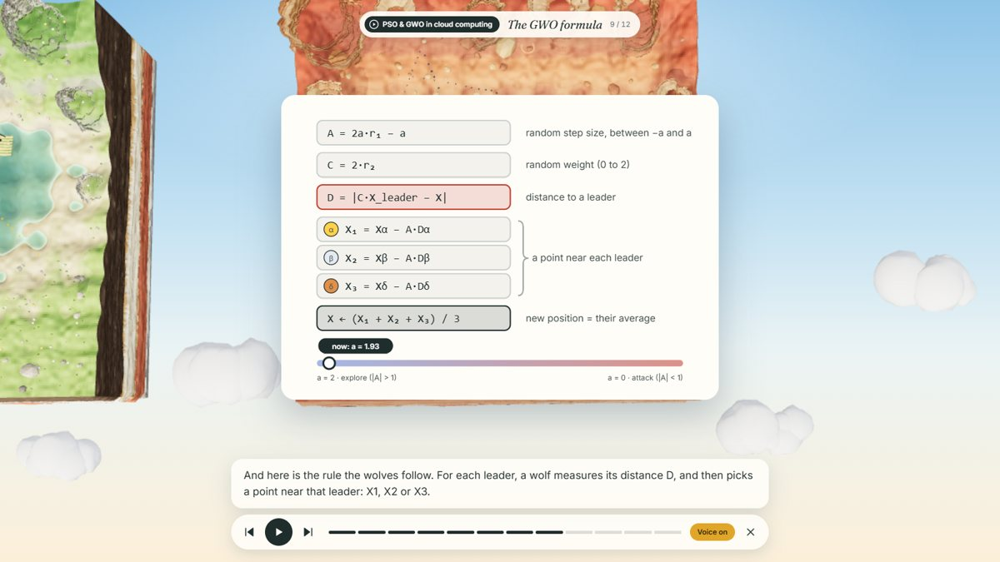<br/>**Video: the GWO formula.** From distance to guesses to their average |
| 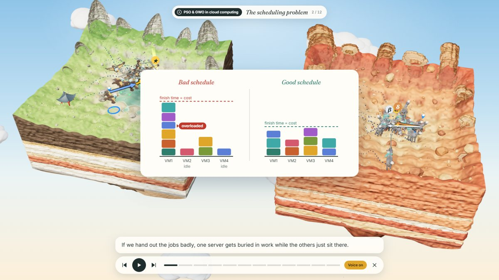<br/>**Video: cloud scheduling.** Bad vs good schedule, makespan as cost | 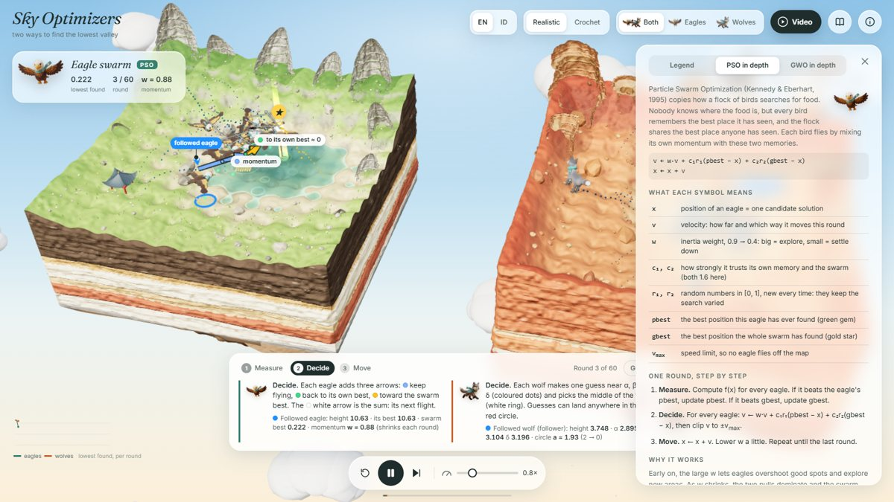<br/>**In depth.** Symbols, pseudocode and trade-offs |
| 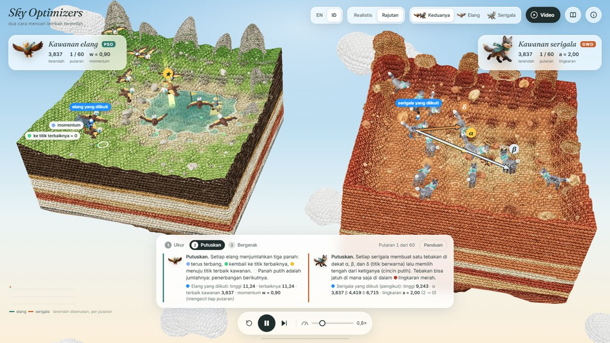<br/>**Crochet style, Bahasa Indonesia** | 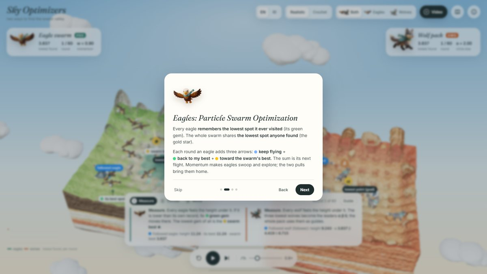<br/>**First-visit introduction** |

<p align="center">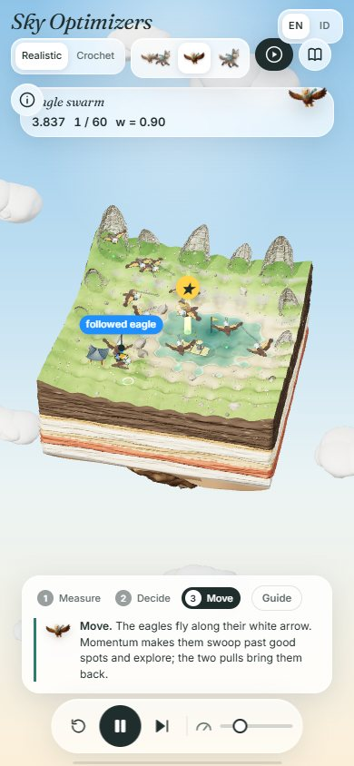<br/><strong>Phone layout</strong></p>

## Try in three steps

1. Open [`index.html`](index.html) (double-click it, or use the demo link above).
2. Read the four-slide introduction, then press **Play**. Click any animal to follow it.
3. Press **Video** in the top bar for the narrated explainer on PSO and GWO in cloud computing.

## Pages and versions

| | English | Bahasa Indonesia |
| :--- | :--- | :--- |
| **Realistic** | [`index.html`](index.html) | [`pages/realistic-id.html`](pages/realistic-id.html) |
| **Crochet** | [`pages/crochet-en.html`](pages/crochet-en.html) | [`pages/crochet-id.html`](pages/crochet-id.html) |

Every page links to the others through the **EN | ID** and **Realistic | Crochet** switches in the top bar.

## Running locally

Prerequisites: a modern browser with WebGL 2 (Chrome, Edge, Firefox, Safari) and an internet connection the first time (three.js and fonts load from a CDN).

**Run.** Double-click [`index.html`](index.html). No server and no install needed.

**Rebuild after editing `src/`** (Python 3.8+):

```bash
python tools/build.py        # or: npm run build
```

**Controls**

| Input | Action |
| :--- | :--- |
| Drag / scroll | Orbit / zoom |
| Click an animal | Follow its arrows and numbers |
| `Space` | Play / pause |
| `→` | Next step |
| `Enter` | Continue (Guide mode) |
| `1` `2` `3` | Both islands / eagles / wolves |
| `R` | Restart |
| ⓘ | Legend, in-depth tabs, landscape picker |
| Video: `Space` `←` `→` `Esc` | Pause, previous / next chapter, close |

> [!TIP]
> For the most natural narration use **Microsoft Edge** (neural "Natural" voices) or **Chrome** (Google voices, including *Bahasa Indonesia*). If no voice exists for the language, the video plays with captions only.

## How the algorithms work

<details open>
<summary><strong>Particle Swarm Optimization (eagles)</strong></summary>

Every eagle remembers its own best spot (**pbest**, green gem) and the swarm shares the best spot anyone found (**gbest**, gold star). Each round:

```
Measure  f(x) for every eagle; update pbest and gbest
Decide   v ← w·v + c1·r1·(pbest − x) + c2·r2·(gbest − x)     (clip to ±vmax)
Move     x ← x + v
```

| Symbol | Meaning | Value |
| :--- | :--- | :--- |
| w | momentum (inertia) | 0.9 → 0.4 over the run: explore first, settle later |
| c1, c2 | trust in own memory / the swarm | 1.6 / 1.6 |
| r1, r2 | random in [0, 1] | fresh every time |
| vmax | speed limit | 0.32 |

</details>

<details open>
<summary><strong>Grey Wolf Optimizer (wolves)</strong></summary>

The three best wolves become the leaders **α, β, δ**; every wolf makes one guess near each and runs to their average:

```
Measure  f(X) for every wolf; the three best are α, β, δ
Decide   A = 2a·r1 − a,  C = 2·r2,  D = |C·X_leader − X|,  Xk = X_leader − A·D
         X ← (X1 + X2 + X3) / 3
Move     run to X;  a falls linearly from 2 to 0
```

While |A| > 1 guesses can land beyond a leader (explore). Once |A| < 1 they always land near the leaders (encircle and attack). The red circle shows a.

</details>

| | PSO · eagles | GWO · wolves |
| :--- | :--- | :--- |
| Guided by | own best + swarm best | three leaders α β δ |
| Memory | yes (pbest, momentum) | no, only this round's leaders |
| Explore → exploit | w: 0.9 → 0.4 | a: 2 → 0 |
| Typical behaviour | fast, can rush together | steady, encircles the best region |
| Used in the cloud for | task scheduling, load balancing | VM placement, energy-aware scheduling |

The full write-up, with every symbol mapped to what is on screen, is in [`docs/ALGORITHMS.md`](docs/ALGORITHMS.md).

## Architecture

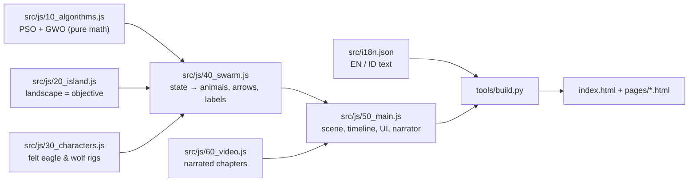

| Module | Contents |
| :--- | :--- |
| [`00_util.js`](src/js/00_util.js) | math helpers, seeded RNG, noise, `t()` translations, number formatting |
| [`05_surface.js`](src/js/05_surface.js) / [`05_yarn.js`](src/js/05_yarn.js) | realistic surface grain / crochet stitch shader |
| [`10_algorithms.js`](src/js/10_algorithms.js) | objectives, `PSO` and `GWO` classes: `evaluate()`, `plan()`, `commit()` |
| [`20_island.js`](src/js/20_island.js) | height field, carved strata walls, rocky underside, water, towers, pavilion |
| [`30_characters.js`](src/js/30_characters.js) | felt eagle and wolf (smooth-union SDF meshes), raft, clouds |
| [`40_swarm.js`](src/js/40_swarm.js) | animal motion, trails, vector arrows, markers, labels |
| [`50_main.js`](src/js/50_main.js) | renderer, Measure/Decide/Move timeline, camera, HUD, narrator, intro, controls |
| [`60_video.js`](src/js/60_video.js) | explainer chapters, diagrams, voice, step-synchronised playback |

The build inlines the CSS and all scripts into each page and fills in the text for the page's language, so every page is a single file that opens by double-click.

## Validation and limitations

**Validation.**
- The algorithms are pure functions of a seed, tested headless on every landscape (see [Testing](#testing)).
- The end-to-end test drives every page in a real browser. It checks for errors, broken positions, overlapping labels, the video and all links.

**Limitations**, stated openly:
- **The landscape is a benchmark, not a cloud workload.** The "in the cloud" video chapters illustrate how a position encodes a schedule; the island itself stays a test function.
- **Two dimensions.** Real problems have many more; 2D is what can be drawn.
- **The video voice is the browser's.** Its quality depends on the voices installed; captions always work.
- **Hardware.** Needs WebGL 2. On a weak integrated GPU it runs around 20–25 fps and lowers its resolution automatically.

## Testing

```bash
# algorithms: both converge on every landscape (Node 18+)
node tools/test_algorithms.js

# every page in a real browser (Python 3.8+, Playwright)
pip install -r requirements-dev.txt && playwright install chrome
python tools/e2e_test.py
```

The same commands are available as `npm test` and `npm run test:e2e`.

## Repository structure

```text
metaheuristik-pso-gwo/
├── index.html                 ← start here (realistic, English) · built
├── pages/                     the other three built versions
│   ├── crochet-en.html
│   ├── realistic-id.html
│   └── crochet-id.html
├── src/                       edit these, then run tools/build.py
│   ├── index.template.html    page markup with {{text}} placeholders
│   ├── i18n.json              all UI and narration text, English + Indonesian
│   ├── css/style.css
│   └── js/                    00_util … 60_video (concatenated in order)
├── assets/mascots/            eagle.png, wolf.png (transparent)
├── tools/
│   ├── build.py               src → index.html + pages/
│   ├── test_algorithms.js     headless convergence test
│   ├── e2e_test.py            browser test of every page
│   └── cutout.py              background removal for the mascot art
├── docs/
│   ├── ALGORITHMS.md          PSO and GWO in depth
│   ├── BRIEF.md               requirements (single source of truth)
│   ├── screenshots/           images used in this README
│   ├── references/
│   │   ├── diorama/           cut-away island and diorama inspiration
│   │   └── style/             needle-felt mascot style
│   └── source-art/            original mascot art
├── AGENTS.md                  notes for coding agents
├── CREDITS.md
├── LICENSE
├── package.json               npm run build | test | test:e2e | serve
└── requirements-dev.txt       Python packages for the dev tools
```

`archive/` (old prototypes, review screenshots) is kept locally and ignored by git.

## Other documentation

| Document | Contents |
| :--- | :--- |
| [docs/ALGORITHMS.md](docs/ALGORITHMS.md) | PSO and GWO in depth, symbols mapped to the screen, cloud-computing connection |
| [docs/BRIEF.md](docs/BRIEF.md) | Requirements and design decisions |
| [CREDITS.md](CREDITS.md) | Libraries, references and papers |
| [AGENTS.md](AGENTS.md) | How to change the project safely |

## License and attribution

Code is released under the [MIT license](LICENSE). Third-party attribution and the papers behind both algorithms are in [CREDITS.md](CREDITS.md).

- Kennedy, J., & Eberhart, R. (1995). *Particle swarm optimization.* Proc. ICNN'95.
- Shi, Y., & Eberhart, R. (1998). *A modified particle swarm optimizer.* IEEE ICEC.
- Mirjalili, S., Mirjalili, S. M., & Lewis, A. (2014). *Grey Wolf Optimizer.* Advances in Engineering Software, 69, 46–61.

---
